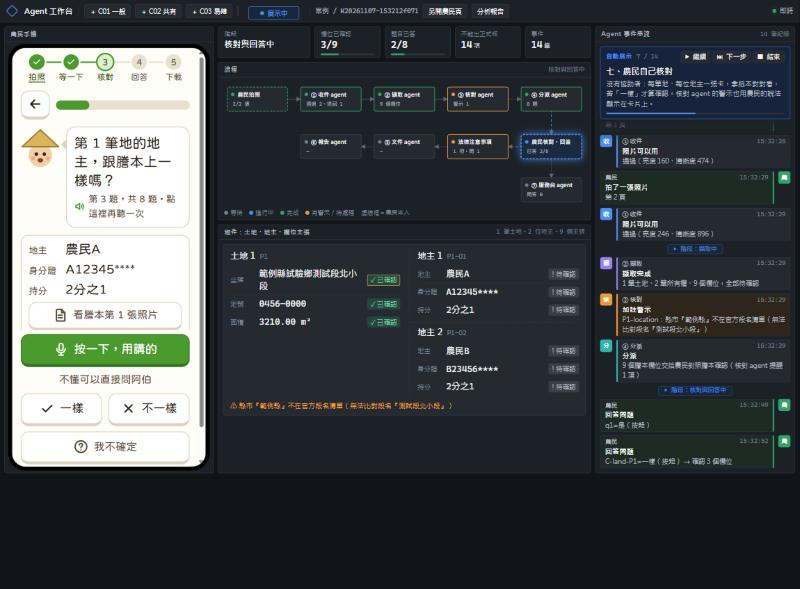
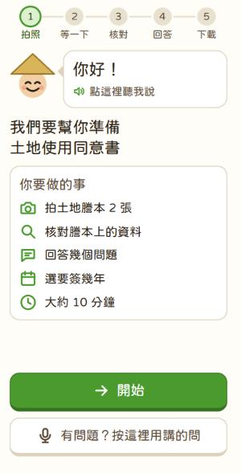
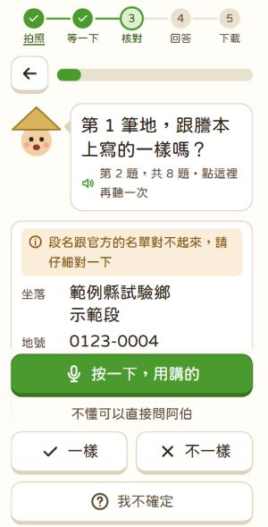
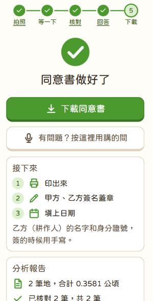
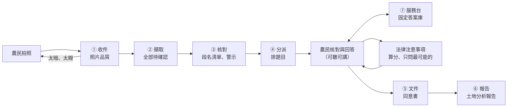

# 土籍登登

**謄本 → 土地使用同意書：讓高齡農民自己完成**

[](https://github.com/ray37669429/hack-day/actions/workflows/tests.yml)

> 農業產銷履歷 AI 黑客松作品。高齡農民用手機拍下土地謄本，背景的 agent 讀出資料、檢查、排出問題；
> 農民只要用「一樣／不一樣」核對、回答幾個是非題，就能下載可以簽名的「土地使用同意書」和一份白話的「土地分析報告」。



<p align="center">
  
  
  
</p>

## 為什麼做這個

產銷履歷的行政工作裡，同一筆土地資料要從謄本抄進土地清單，再重打一次「土地使用同意書」——坐落、地號、面積、地主、持分，抄兩三次，費時又容易抄錯（背景見[白皮書](docs/whitepaper.md)）。
地主多半是長輩，看不清小字、不熟電腦，也怕被騙，只能拜託別人代填。

我們的做法：**農民只做他最清楚的事，其他交給 agent；但 AI 永遠不能自己「確認」任何資料。**

## 快速展示（約 5 分鐘，不需要任何金鑰）

```bash
git clone https://github.com/ray37669429/hack-day.git
cd hack-day
py -3.10 -m venv .venv
.venv\Scripts\python -m pip install -r requirements.txt
.venv\Scripts\python -m uvicorn app.main:app --port 8001
```

打開 <http://localhost:8001/>（Agent 工作台），按上方藍色的 **「▶ 自動展示」**。
系統用虛構的假謄本（C02：一筆地、兩位地主共有）自己跑完整個流程，約 2 分鐘、14 步，右上角逐步解說：

1. 拍到一張太暗的照片 → 收件 agent 當場用農民聽得懂的話請他重拍
2. 擷取 agent 讀出土地與地主（全部標「待確認」）→ 核對 agent 比對內政部段名清單 → 分派 agent 排題目
3. 農民一筆一筆核對「跟謄本一樣嗎？」、按麥克風問阿伯問題
4. 依答案算分，只問最可能的法律注意事項（共有土地、租約、三七五）並追問
5. 產生正式版同意書與土地分析報告，可直接下載

展示用假謄本與事先產生的語音檔，**沒有 `.env`、沒有 API 金鑰也能完整跑完**。
要讓 AI 讀真的謄本照片，才需要在 `.env` 填 `OPENAI_API_KEY`（照 `.env.example`，絕對不要 commit）。
macOS／Linux 把 `py -3.10` 換成 `python3.10`、`.venv\Scripts\python` 換成 `.venv/bin/python`。

## 功能

### 農民手機頁（`web/farmer.html`）——給高齡農民

- **大字、大按鈕、一次只問一件事**：內文至少 20px、按鈕至少 56px；只用點的，不用滑、不用長按。
- **可聽可講**：每句話都會唸（OpenAI TTS 事先產生的語音檔）；按一顆麥克風就能用講的回答，聽到後會唸回確認。
- **不懂直接問阿伯**：同一顆麥克風，問「為什麼要一樣？」「要多久？」，阿伯從**固定答案庫**回答；問到法律就請他問地政事務所或農會。
- **自己核對**：每筆地、每位地主一張卡，對照紙本按「一樣／不一樣／我不確定」。看不清、不一樣的地方會建議「重拍第 N 張」。
- **隨時回到某一步**：步驟列可以點回去，選要重拍哪一張，系統會自動重讀謄本。
- **不用帳號密碼**：用專屬連結開啟。

### 背景 agent——固定流程，每個 agent 只做一件事

| Agent | 做什麼 | 不能做什麼 |
| --- | --- | --- |
| ① 收件 | 拍照當下檢查亮度、清晰度，不行就當場請他重拍 | 讀內容 |
| ② 擷取 | 讀出坐落、地號、面積、地主、持分，**全部建立成「待確認」** | 把任何欄位標成已確認 |
| ③ 核對 | 比對內政部段名清單、地號格式、同地號、持分加總，加註警示 | 自己決定哪個對 |
| ④ 分派 | 排出要問農民的題目（核對、耕作方式、法律注意事項、期間） | 跳過確認 |
| 法律注意事項 | 用固定規則**算分**，只問最可能的幾題並依答案追問；法條一律標「待法律專業確認」 | 下法律結論 |
| ⑤ 文件 | 依紙本版面產生同意書：公頃面積用**已確認**的數字換算，提醒寫進備註；有沒處理好的就標「草稿」 | 在資料未確認時出正式版 |
| ⑥ 報告 | 產生白話的「土地分析報告」：土地與面積、地主與持分、回答、法律注意事項的分數與理由、待辦 | 給法律意見 |
| ⑦ 服務台 | 回答農民的問題，只從固定答案庫挑 | 讓 LLM 自由說話 |

### Agent 工作台（`web/dev.html`）——給評審與開發者

一個電腦畫面放得下（不用捲動）：左邊是真的農民手機頁，中間是即時流程圖、KPI 與物件（土地、地主、每個欄位的狀態與來源頁），右邊是 agent 事件串流。
**「▶ 自動展示」** 會自己跑完整個流程並逐步解說，可暫停、下一步、結束。

## 系統怎麼運作



- **資料只存一份**：每個案例一個 JSON；同意書、報告、畫面都是從它產生的「視圖」。
- **只有「動作」能改資料**（`app/actions.py`）：每個動作檢查「誰在做」，並寫一筆操作紀錄；agent 想確認欄位會被直接擋下。
- **擷取可以換引擎**：假謄本用標準答案（`oracle`），真照片用 OpenAI 視覺模型（`vision`，經過 `app/llm/harness.py`）。

## 安全護欄（硬規則，見 [AGENTS.md](AGENTS.md)）

1. **不捏造、不猜**：看不清、缺漏、衝突的欄位一律「待確認」，不補值。
2. **AI 不能確認**：只有農民本人能把欄位標成已確認；看不清的欄位不能靠「一樣」確認。
3. **給農民的話都是固定範本**：題目、服務台回答、待辦，不讓 LLM 自由產生。
4. **法律只提醒、不判斷**：法條都標「待法律專業確認」，請他問地政事務所或農會。
5. **面積換算規則明確**：平方公尺 ÷ 10000、× 持分，小數 4 位四捨五入；原始值保留不覆蓋。
6. **未確認就是草稿**：簽名蓋章、日期、乙方耕作人留白手寫。
7. **個資**：只用虛構或遮蔽資料；原始檔與產出檔不進 git；農民頁看不到地址。語音只送固定句子。

## 技術

| 層 | 用什麼 |
| --- | --- |
| 後端 | Python 3.10、FastAPI、Pydantic；案例存 JSON |
| AI | OpenAI（視覺擷取，經 LLM harness）；`gpt-4o-mini-tts` 事先產生國語語音 |
| 前端 | 純 HTML／JS（不用打包工具）、瀏覽器語音辨識、jf open 粉圓體 |
| 文件 | python-docx 依紙本版面產生同意書與分析報告 |
| 測試 | pytest 102 個（端到端流程、法律規則、面積換算、服務台、語音不卡住）；GitHub Actions 每次 push 自動跑 |

## 資料夾

| 位置 | 放什麼 |
| --- | --- |
| `app/` | 後端：資料模型、動作層、各 agent（`app/agents/`）、LLM harness |
| `web/` | 前端：農民手機頁、Agent 工作台、語音檔（`web/audio/`） |
| `tools/` | 同意書產生器、語音產生、擷取評估 |
| `tests/` | 測試 |
| `templates/` | 空白同意書範本 |
| `data/samples/` | **虛構**的假謄本與標準答案（C01 一般、C02 共有、C03 易錯） |
| `data/raw/`、`data/output/` | 原始檔與產出（**不進 git**） |
| `docs/` | 白皮書與設計文件 |

## 文件

- 需求與驗收：[白皮書](docs/whitepaper.md)、[待辦](docs/TODO.md)、[驗收記錄](docs/acceptance-log.md)
- 設計：[後端](docs/backend-design.md)、[前端與工作台](docs/frontend-design.md)、[高齡農民介面與 agent](docs/farmer-ux-agents.md)、[語音](docs/voice-design.md)、[Ontology](docs/ontology-design.md)
- 規則：[法律注意事項](docs/legal-questions.md)、[同意書版面與欄位](docs/agreement-spec.md)、[LLM harness](docs/llm-harness.md)
- 前端使用說明：[web/README.md](web/README.md)

## 開發

```bash
.venv\Scripts\python -m pytest -q                                   # 測試（不需要金鑰）
.venv\Scripts\python -m uvicorn app.main:app --reload --port 8001  # 開發用（改程式自動重啟）
python tools/collect_prompts.py                                     # 新增或修改要唸的句子後
python tools/gen_tts.py --engine openai --lang zh --missing         # 補產生語音檔（需要金鑰）
```

- `main` 永遠可以跑、可以展示；小步 commit，commit 前先跑測試。
- 規則只有一份：[AGENTS.md](AGENTS.md)（Codex 直接讀；Claude Code 透過 [CLAUDE.md](CLAUDE.md) 讀）。
- 金鑰只放 `.env`，不要 commit。

歡迎參與：在 GitHub 網頁點檔案右上角的 ✏️ 就能編輯並送出 Pull Request，詳見 [CONTRIBUTING.md](CONTRIBUTING.md)。每個 PR 會自動跑測試。

## 團隊

| 角色 | 負責 |
| --- | --- |
| 隊員 A（地政背景） | 謄本欄位辨識、地號與面積核對 |
| 隊員 B（電腦老師） | 工具與流程、確保現場可重跑 |
| 隊員 C（張永錫，白皮書作者） | 需求、計時、範圍決策、驗收 |
| 實際使用者（永錫的太太） | 確認成果、試用 |

> 本專案所有謄本、姓名、身分證號都是虛構的測試資料，不具任何效力。
