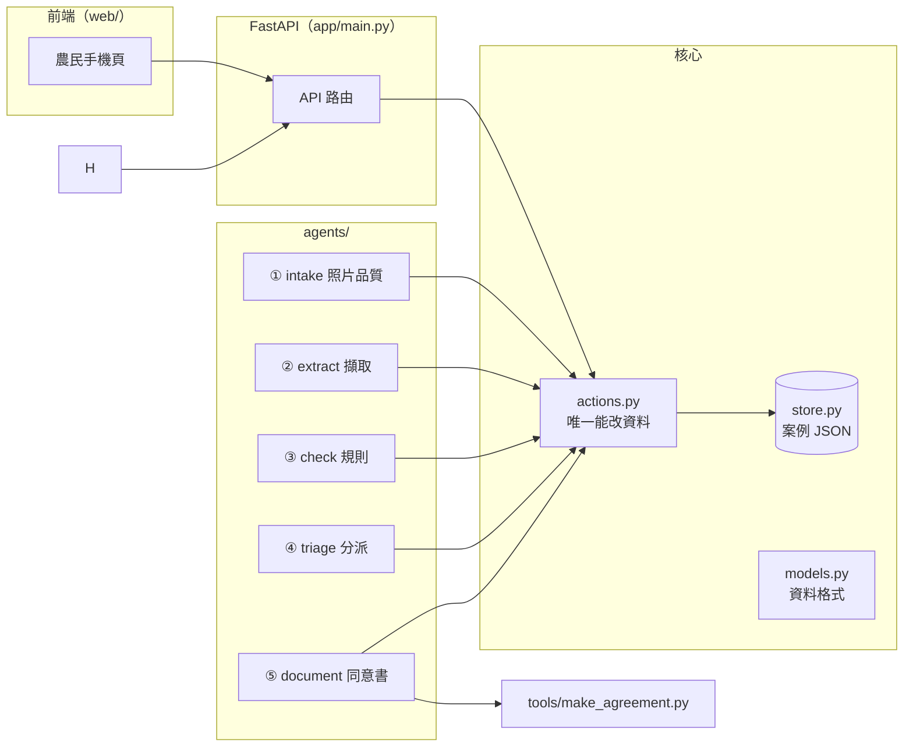

# 後端設計

> 狀態：骨架已建立（`app/`），可用假謄本從頭跑到尾。延續 [ontology-design.md](ontology-design.md)、[farmer-ux-agents.md](farmer-ux-agents.md)。

## 1. 原則

1. **資料只存一份**：每個案例一個 JSON（`data/output/cases/<id>/case.json`），Excel、Word、畫面都是從它產生。
2. **只有「動作」能改資料**（`app/actions.py`）。每個動作檢查「誰在做」和「能不能做」，並寫一筆操作紀錄。
3. **agent 不能確認任何欄位**。擷取 agent 只能建立「待確認」；**只有農民本人**（actor `farmer`）能用「一樣／不一樣」確認或退回。這由動作層擋下，不靠 agent 自律。協助者角色已於 2026-11-07 取消。
4. **固定流程，不是自由發揮**：照片收齊 → 擷取 → 核對 → 分派，依序自動觸發。
5. **擷取的輸出格式 = 假謄本答案檔格式**（`answer.json`），所以可以用答案檔當「完美擷取」測試整條流程，再換成真的 AI。

## 2. 架構



## 3. 資料模型（`app/models.py`，開工後凍結）

| 物件 | 重點欄位 | 說明 |
| --- | --- | --- |
| `Case` | `id`、`stage`、`farmer_token`、`sample_id` | 一個案例。`stage`：收照片中 → 擷取中 → 待核對 → 已產生文件 |
| `Photo` | `page`、`file`、`ok`、`reason`、`brightness`、`sharpness` | 農民拍的照片與品質檢查結果 |
| `Parcel` | `pid`、`source` | 一筆土地（實際值放在擷取主張裡） |
| `Ownership` | `oid`、`pid`、`source` | 一筆所有權（一筆地可以有多筆） |
| `FieldClaim` | `id`、`target`、`field`、`ai_value`、`value`、`status`、`note`、`flags`、`source` | **擷取主張**。`status`：待確認／已確認／退回 |
| `FarmerAnswer` | `question`、`value`、`channel`、`transcript` | 農民回答。`channel`：按鈕／語音；語音要存辨識原文 |
| `Task` | `to`、`text`、`done` | 只在流程失敗時記錄（保留給舊資料）；農民的待辦由 `actions.todo()` 即時算出 |
| `Event` | `at`、`actor`、`action`、`detail` | 操作紀錄 |

`FieldClaim.field` 的固定值：`location`、`lot_no`、`area_m2`、`owner`、`id_no`、`share`。

## 4. 誰能做什麼（動作層強制）

| 動作 | 農民 | agent／系統 |
| --- | --- | --- |
| 上傳照片 | ✅ | — |
| 建立擷取主張（待確認） | — | ✅ 只有 extract |
| 加註規則警示 | — | ✅ 只有 check |
| 回答題目（含核對題、法律題、期間） | ✅ | — |
| 確認／退回欄位（核對題答「一樣／不一樣」） | ✅ | ❌ **一律拒絕** |
| 產生同意書、分析報告 | — | ✅ document、report（題目答完自動產生；未全部確認時只能是草稿） |
| 寫操作紀錄 | — | ✅ 各 agent（含服務台 faq） |

本筆面積、權利面積由 `app/agents/area.py` 用**已確認**的面積與持分計算（÷ 10000、× 持分，小數 4 位四捨五入）；實施期間來自農民選的年數；乙方耕作人留白手寫。

## 5. API

農民用專屬連結（`farmer_token`）存取。`/api/cases` 只給本機管理與測試用，對外開放前必須拿掉或加登入。

| 方法 | 路徑 | 做什麼 |
| --- | --- | --- |
| `POST` | `/api/cases` | （本機管理）建立案例，回傳農民連結。可帶 `sample_id`（C01–C03） |
| `GET` | `/api/cases/{id}` | （本機管理）案例全部資料、`missing`、`legal`、`todo` |
| `GET` | `/api/f/{token}` | 農民畫面資料：`stage`、`lands`、`photos`、`questions`（依序：q1 → 核對題 → q2、q3 → 法律題 → 期間）、`answers`、`documents`、`todo`、`report` |
| `POST` | `/api/f/{token}/photos` | 上傳一張照片，立即回傳品質檢查與逐項 `checks`；收齊後自動擷取 |
| `GET` | `/api/f/{token}/photos/{page}` | 本案該頁最後一張合格照片 |
| `POST` | `/api/f/{token}/answers` | 回答一題；題目都答完就自動產生同意書與分析報告 |
| `GET` | `/api/f/{token}/documents/{name}` | 下載同意書 Word |
| `GET` | `/api/f/{token}/report` | 下載土地分析報告 Word |
| `POST` | `/api/f/{token}/ask` | 服務台：`{text, channel}` → 阿伯從固定答案庫回答 `{id, answer, say, suggestions}` |
| `GET` | `/` | 前端靜態檔（`web/`） |

題目格式：`{id, text, say, kind, options[{value,label}], why, legal, card}`；`kind` 有 `yesno`、`who`、`cat`、`have`、`same`（核對）、`years`（期間）。

## 6. 背景 agent

| Agent | 檔案 | 觸發 | 做什麼 |
| --- | --- | --- | --- |
| ① 收件 | `agents/intake.py` | 上傳照片時（同步） | 亮度 ≥ 90、清晰度 ≥ 250 才通過；門檻與測試台相同，依真實照片校正（清楚約 520–550、模糊約 150） |
| ② 擷取 | `agents/extract.py` | 照片收齊（背景） | 兩種引擎：`oracle` 讀假謄本答案檔；`vision` 透過 LLM harness 呼叫 OpenAI（見 [llm-harness.md](llm-harness.md)），輸出格式與答案檔相同 |
| ③ 核對 | `agents/check.py` | 擷取完成 | 段名比對內政部官方清單（`app/refdata/`）、地號格式、同地號不同段、持分加總、看不清的欄位 |
| ④ 分派 | `agents/triage.py` | 核對完成、每次回答 | 排出農民要回答的全部題目（核對題、q1–q3、依分數選出的法律題、期間）；q1 答「不是」就停止 |
| ⑤ 文件 | `agents/document.py` | 題目答完（之後改答案會重做） | 依送出條件出正式版或草稿，呼叫 `tools/make_agreement.py`；備註放法律注意事項的固定短句 |
| ⑥ 報告 | `agents/report.py` | 文件之後 | 「土地分析報告」：土地與面積、地主與持分、回答、法律注意事項（分數、理由、參考）、待辦、同意書狀態；全部固定範本 |
| ⑦ 服務台 | `agents/faq.py` | 農民按「問問題」 | 從固定答案庫挑答案；「下一步」依案例狀態套範本；法律問題不判斷，請他問地政事務所或農會 |
| 法律注意事項 | `agents/legal.py` | 每次回答 | 規則打分，只問最可能的幾題並追問（見 [legal-questions.md](legal-questions.md)） |

流程由 `app/pipeline.py` 串接：照片收齊後，依序執行 ②③④，任何一步失敗就把案例標成「需人工處理」並建立任務，不重試到看起來成功。

## 7. 語音

- **朗讀**：固定句子事先產生音檔（`tools/gen_tts.py`），後端只當靜態檔提供。國語用 OpenAI TTS（`gpt-4o-mini-tts`，mp3，2026-11-07 起採用）；閩南語試驗用 Fun-CosyVoice3；本機 Qwen3-TTS 留作備案。服務台會變動的回答（例如「下一步」）畫面顯示完整文字，但唸固定句子，才有音檔。
- **辨識**：在瀏覽器做，後端只收「判斷後的答案＋原文」，不收錄音檔。
- 動態句子（例如念地號）之後才做：`POST /api/tts` 由後端呼叫 TTS 並快取，金鑰只在後端。

## 8. 個資與安全

- 照片、案例 JSON、產生的 Word 都在 `data/output/`，不進 git。
- 農民端 API 不回傳身分證號、他人姓名。
- 操作紀錄只記欄位名稱與動作，不記身分證號。
- 農民連結使用隨機 token（128 位元）。`/api/cases` 只開在本機；要給外網用時必須拿掉或加登入。
- 核對卡會顯示同一張謄本上其他共有人的姓名與遮蔽證號（來自農民自己拍的照片），但不顯示地址。

## 9. 執行

```bash
py -3.10 -m venv .venv
.venv\Scripts\python -m pip install -r requirements.txt
.venv\Scripts\python -m pytest -q
.venv\Scripts\python -m uvicorn app.main:app --reload --port 8001
```

測試（`tests/test_flow.py`）涵蓋：壞照片退回、C03 全流程到正式版、agent 不能確認欄位、農民答「不是」時強制草稿、共有土地分成兩份同意書。

## 10. 單人開發順序

| 順序 | 工作 | 檔案 |
| --- | --- | --- |
| 1 | 前端接後端（拍照、回答、核對、產生同意書改呼叫 API） | `web/` |
| 2 | 視覺 AI 擷取（`vision` 引擎） | `app/agents/extract.py` |
| 3 | 語音實機（HTTPS、手機收音） | `web/` |
| 4 | 整合測試與展示準備 | 全部 |

1 和 2 檔案不重疊，可以讓 Claude Code 和 Codex 同時各做一項。詳細時間表見 [3h-mvp-plan.md](3h-mvp-plan.md)。
