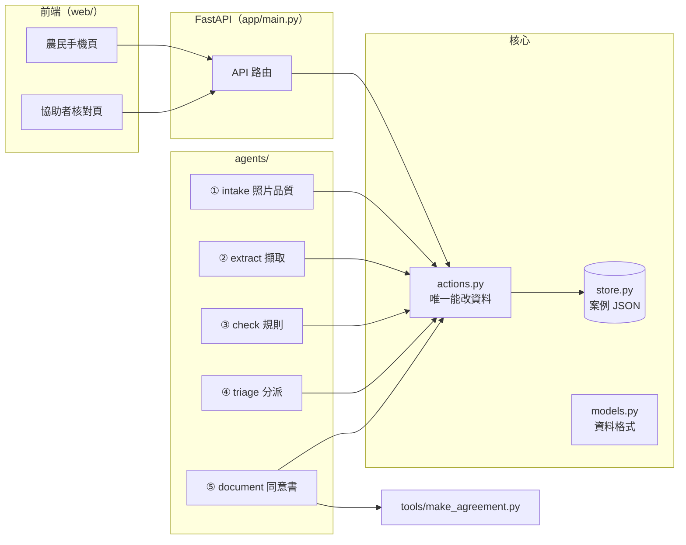

# 後端設計

> 狀態：骨架已建立（`app/`），可用假謄本從頭跑到尾。延續 [ontology-design.md](ontology-design.md)、[farmer-ux-agents.md](farmer-ux-agents.md)。

## 1. 原則

1. **資料只存一份**：每個案例一個 JSON（`data/output/cases/<id>/case.json`），Excel、Word、畫面都是從它產生。
2. **只有「動作」能改資料**（`app/actions.py`）。每個動作檢查「誰在做」和「能不能做」，並寫一筆操作紀錄。
3. **agent 不能確認任何欄位**。擷取 agent 只能建立「待確認」；只有協助者能確認、退回。這由動作層擋下，不靠 agent 自律。
4. **固定流程，不是自由發揮**：照片收齊 → 擷取 → 核對 → 分派，依序自動觸發。
5. **擷取的輸出格式 = 假謄本答案檔格式**（`answer.json`），所以可以用答案檔當「完美擷取」測試整條流程，再換成真的 AI。

## 2. 架構



## 3. 資料模型（`app/models.py`，開工後凍結）

| 物件 | 重點欄位 | 說明 |
| --- | --- | --- |
| `Case` | `id`、`stage`、`farmer_token`、`sample_id` | 一個案例。`stage`：收照片中 → 擷取中 → 待核對 → 已產生文件 |
| `Photo` | `page`、`file`、`ok`、`reason`、`brightness`、`sharpness` | 農民拍的照片與品質檢查結果 |
| `Parcel` | `pid`、`source` | 一筆土地（實際值放在擷取主張裡） |
| `Ownership` | `oid`、`pid`、`source` | 一筆所有權（一筆地可以有多筆） |
| `FieldClaim` | `id`、`target`、`field`、`ai_value`、`value`、`status`、`note`、`flags`、`source` | **擷取主張**。`status`：待確認／已確認／退回 |
| `FarmerAnswer` | `question`、`value`、`channel`、`transcript` | 農民回答。`channel`：按鈕／語音；語音要存辨識原文 |
| `Manual` | `area_ha`、`right_area_ha`、`period`、`cultivator` | 協助者人工填的欄位（換算規則未確認前不自動算） |
| `Task` | `to`、`text`、`done` | 給協助者的待辦 |
| `Event` | `at`、`actor`、`action`、`detail` | 操作紀錄 |

`FieldClaim.field` 的固定值：`location`、`lot_no`、`area_m2`、`owner`、`id_no`、`share`。

## 4. 誰能做什麼（動作層強制）

| 動作 | 農民 | 協助者 | agent |
| --- | --- | --- | --- |
| 上傳照片 | ✅ | ✅ | — |
| 建立擷取主張（待確認） | — | — | ✅ 只有 extract |
| 加註規則警示 | — | — | ✅ 只有 check |
| 建立任務 | — | ✅ | ✅ triage |
| 回答 3 題 | ✅ | — | — |
| 確認／修正／退回欄位 | — | ✅ | ❌ **一律拒絕** |
| 填人工欄位 | — | ✅ | — |
| 產生同意書 | — | ✅ | ✅ document（未全部確認時只能出草稿） |

## 5. API

農民用專屬連結（`farmer_token`）存取，看不到身分證號與其他人的資料；協助者端 MVP 只在本機使用。

| 方法 | 路徑 | 誰用 | 做什麼 |
| --- | --- | --- | --- |
| `POST` | `/api/cases` | 協助者 | 建立案例，回傳案例編號與農民連結。可帶 `sample_id`（C01–C03）使用假謄本 |
| `GET` | `/api/cases/{id}` | 協助者 | 案例全部資料＋「還不能出正式版的原因」 |
| `GET` | `/api/f/{token}` | 農民 | 農民畫面需要的資料：目前步驟、要拍幾張、土地清單（只有段名與地號）、已答題目 |
| `POST` | `/api/f/{token}/photos` | 農民 | 上傳一張照片，立即回傳品質檢查結果；收齊後自動觸發擷取 |
| `POST` | `/api/f/{token}/answers` | 農民 | 回答一題：`question`、`value`、`channel`、`transcript` |
| `POST` | `/api/cases/{id}/claims/{claim_id}/confirm` | 協助者 | 確認（可帶修正後的值） |
| `POST` | `/api/cases/{id}/claims/{claim_id}/reject` | 協助者 | 退回並建立補拍任務 |
| `PUT` | `/api/cases/{id}/manual` | 協助者 | 填公頃面積、權利面積、實施期間、耕作人 |
| `POST` | `/api/cases/{id}/documents` | 協助者 | 產生同意書 Word（每位所有權人一份；未完成時是草稿） |
| `GET` | `/api/cases/{id}/documents/{name}` | 協助者 | 下載 Word |
| `GET` | `/` | 全部 | 前端靜態檔（`web/`），測試台在 `/web/prototype.html` |

## 6. 背景 agent

| Agent | 檔案 | 觸發 | 做什麼 |
| --- | --- | --- | --- |
| ① 收件 | `agents/intake.py` | 上傳照片時（同步） | 亮度 ≥ 90、清晰度 ≥ 250 才通過；門檻與測試台相同，依真實照片校正（清楚約 520–550、模糊約 150） |
| ② 擷取 | `agents/extract.py` | 照片收齊（背景） | 兩種引擎：`oracle` 讀假謄本答案檔；`vision` 透過 LLM harness 呼叫 OpenAI（見 [llm-harness.md](llm-harness.md)），輸出格式與答案檔相同 |
| ③ 核對 | `agents/check.py` | 擷取完成 | 段名比對內政部官方清單（`app/refdata/`）、地號格式、同地號不同段、持分加總、看不清的欄位 |
| ④ 分派 | `agents/triage.py` | 核對完成 | 謄本欄位全部給協助者；3 題給農民；農民答「不是」「不確定」時加任務 |
| ⑤ 文件 | `agents/document.py` | 協助者按「產生」 | 依送出條件出正式版或草稿，呼叫 `tools/make_agreement.py` |

流程由 `app/pipeline.py` 串接：照片收齊後，依序執行 ②③④，任何一步失敗就把案例標成「需人工處理」並建立任務，不重試到看起來成功。

## 7. 語音

- **朗讀**：固定句子事先產生音檔（`tools/gen_tts.py`），後端只當靜態檔提供。本機引擎：Qwen3-TTS（國語）、Fun-CosyVoice3（閩南語，試驗中）；雲端可選 Qwen3 TTS API 或 Gemini TTS。
- **辨識**：在瀏覽器做，後端只收「判斷後的答案＋原文」，不收錄音檔。
- 動態句子（例如念地號）之後才做：`POST /api/tts` 由後端呼叫 TTS 並快取，金鑰只在後端。

## 8. 個資與安全

- 照片、案例 JSON、產生的 Word 都在 `data/output/`，不進 git。
- 農民端 API 不回傳身分證號、他人姓名。
- 操作紀錄只記欄位名稱與動作，不記身分證號。
- 農民連結使用隨機 token（128 位元）。協助者端 MVP 只開在本機；要給外網用時必須加登入。

## 9. 執行

```bash
py -3.10 -m venv .venv
.venv\Scripts\python -m pip install -r requirements.txt
.venv\Scripts\python -m pytest -q
.venv\Scripts\python -m uvicorn app.main:app --reload --port 8001
```

測試（`tests/test_flow.py`）涵蓋：壞照片退回、C03 全流程到正式版、agent 不能確認欄位、農民答「不是」時強制草稿、共有土地分成兩份同意書。

## 10. 單人開發順序

| 順序 | 工作 | 檔案 |
| --- | --- | --- |
| 1 | 前端接後端（拍照、回答、核對、產生同意書改呼叫 API） | `web/` |
| 2 | 視覺 AI 擷取（`vision` 引擎） | `app/agents/extract.py` |
| 3 | 語音實機（HTTPS、手機收音） | `web/` |
| 4 | 整合測試與展示準備 | 全部 |

1 和 2 檔案不重疊，可以讓 Claude Code 和 Codex 同時各做一項。詳細時間表見 [3h-mvp-plan.md](3h-mvp-plan.md)。
