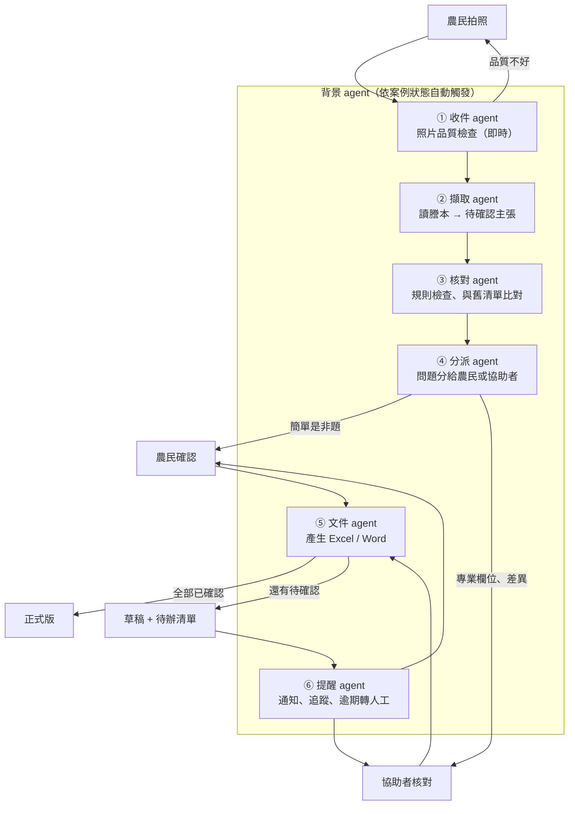

# 設計討論稿：高齡農民的簡化介面 + 背景 Agent 系統

> 狀態：討論稿，尚未定案。延續 [ontology-design.md](ontology-design.md)，把目標用戶從「行政協助者」擴大到**農民本人**。

## 1. 一句話設計原則

**農民只做三件事：拍照、回答「是／不是」、簽名。其他全部交給背景 agent 和協助者。**

## 2. 誰會用這個系統

| 角色 | 是誰 | 會做什麼 | 不該要他做的事 |
| --- | --- | --- | --- |
| **農民** | 所有權人、耕作人，多為高齡 | 拍謄本、確認「這是我的地嗎」、選類別、簽名蓋章 | 逐欄核對面積、地號、持分；學新 App；記帳號密碼 |
| **協助者** | 行政人員（如永錫的太太）、產銷班幹部、農會輔導員、農民的子女 | 核對專業欄位、處理退回、出正式文件 | 重複抄寫 |
| **背景 agent** | 程式 | 檢查照片、擷取、比對、分派問題、產文件、提醒 | 確認任何值、替人做決定 |

這個分工的關鍵是：**把「需要專業判斷的核對」從農民身上移到協助者身上**。農民只回答他本人最清楚的事（是不是我的地、誰在耕作、怎麼耕作）。

## 3. 高齡友善 UI 規則

### 看得清楚
- 內文至少 **20px**，重要數字 28px 以上；不用淺灰字。
- 高對比（深字淺底），顏色之外一定搭配文字或圖示，不靠顏色區分狀態。
- 每個按鈕都要有**圖示 + 文字**，不用只有圖示的按鈕。

### 點得到
- 按鈕高度至少 **56px**，按鈕之間留足間距。
- 只用「點一下」：不用滑動、長按、雙擊、拖曳。
- 每個畫面**只有一個主要按鈕**。

### 看得懂
- 一個畫面只做一件事，一次只問一個問題。
- 用農民自己的說法，例如「土地謄本」「地號」，不用「上傳」「同步」「提交」。
- 用**認得出來**取代**記得起來**：問「這是你的地嗎？」並附上謄本照片的那一小塊，而不是請他輸入地號。
- 支援**語音朗讀**每個問題；回答可以用說的（國語、台語是否支援待討論）。

### 不怕按錯
- 沒有不能反悔的按鈕；按錯可以「回上一步」。
- 每題都有「**我不確定**」按鈕，按下去就轉給協助者，不卡住農民。
- 中斷了（接電話、沒電）再打開會停在原處。

### 不用登入
- 不要求帳號密碼。由協助者傳一個專屬連結，或用 LINE 登入。
- 子女可以代替長輩操作（代理人）。

## 4. 農民端只有四個畫面

```text
┌──────────────────────┐  ┌──────────────────────┐
│ ① 拍謄本              │  │ ② 收到了              │
│                      │  │                      │
│  ┌────────────────┐  │  │   ✔ 已經收到 2 張     │
│  │  對準框框        │  │  │                      │
│  │  （相機畫面）     │  │  │   處理好會用 LINE    │
│  └────────────────┘  │  │   通知你，不用等      │
│  第 1 張，共 2 張      │  │                      │
│                      │  │                      │
│ [ 📷  拍  照 ]        │  │ [ 🏠  回到首頁 ]      │
└──────────────────────┘  └──────────────────────┘
┌──────────────────────┐  ┌──────────────────────┐
│ ③ 請你確認（第 1/3 題）│  │ ④ 簽名               │
│  🔊 唸給我聽          │  │                      │
│  這是你的地嗎？        │  │  同意書已經準備好     │
│  ┌────────────────┐  │  │  請到 ○○ 找 △△ 簽名  │
│  │ 謄本照片局部     │  │  │  （或在螢幕上簽名，  │
│  └────────────────┘  │  │   待討論）           │
│  霧峰區 ○○段 123 號    │  │                      │
│ [ ✔ 是 ] [ ✘ 不是 ]   │  │ [ 📞 打給 △△ ]       │
│ [ ？ 我不確定 ]        │  │                      │
└──────────────────────┘  └──────────────────────┘
```

- **① 拍謄本**：拍完 agent 馬上檢查照片品質，太暗、反光、切到邊就**當場**請他重拍（「有點暗，到亮一點的地方再拍一次」），不要等到隔天才退件。
- **② 收到了**：明確告訴他接下來不用做事、會怎麼被通知。
- **③ 確認**：每題都是「是／不是／我不確定」或二到四個大選項（例如類別：分耕、輪耕、託耕、承租），一頁一題。
- **④ 簽名**：簽名蓋章是法律行為，第一版建議維持紙本、由協助者安排；線上簽名要另外確認是否有效。

協助者端則是先前討論的「核對工作台」（Excel 核對表或小網頁），可以用比較密的介面。

## 5. 背景 Agent 系統

### 設計立場：固定流程 + 小而專的 agent，不做「自由發揮」的多 agent

高齡用戶的系統最重要的是**可預期、可追溯**。所以我們用**固定的狀態流程**串起幾個單一職責的 agent，每個 agent 只能呼叫 Ontology 裡被允許的 Action。這對應 Palantir 的做法：Automate（物件狀態改變就觸發）+ AIP Logic（LLM 步驟）+ Action（受控的寫入）。



### 每個 agent 的職責與權限

| Agent | 何時觸發 | 做什麼 | **可以** | **不可以** |
| --- | --- | --- | --- | --- |
| ① 收件 | 收到照片 | 檢查模糊、反光、缺角、頁數 | 請農民重拍 | 擷取內容 |
| ② 擷取 | 照片通過檢查 | 視覺 LLM 讀欄位，附頁碼、原文、照片位置 | 建立「待確認」主張 | 寫入已確認值 |
| ③ 核對 | 擷取完成 | 先跑固定規則（地號格式、持分加總、面積單位），再與舊清單比對 | 標記差異、缺漏、重複 | 自己選哪個對 |
| ④ 分派 | 核對完成 | 把每個待確認項目分給「農民」或「協助者」 | 建立待辦任務 | 跳過確認 |
| ⑤ 文件 | 有欄位被確認 | 依送出條件產生文件 | 出正式版或草稿 | 在未全部確認時出正式版 |
| ⑥ 提醒 | 任務逾期、租約將到期 | 發提醒；超過期限轉給協助者 | 通知**本案已登記的農民與協助者** | 聯絡其他第三人、催促簽名 |

### 分派規則（農民 vs 協助者）

| 問題類型 | 例子 | 給誰 |
| --- | --- | --- |
| 本人最清楚的事 | 這是你的地嗎？誰在耕作？哪一種耕作方式？ | 農民 |
| 需要專業的核對 | 面積、持分、地號、統一編號是否擷取正確 | 協助者 |
| 衝突或看不清楚 | 謄本和舊清單不一致、照片模糊 | 協助者 |
| 農民按「我不確定」 | 任何題目 | 自動轉協助者 |

### 共通護欄

- 每個 agent 的每次動作都寫入**操作紀錄**（誰、何時、改了什麼、依據哪張照片）。
- agent 失敗或不確定時，**一律轉人工**，不重試到「看起來成功」。
- 農民端的訊息全部由固定範本產生，不讓 LLM 自由發揮措辭，避免說錯話或語氣施壓。

## 6. 對既有設計的影響

- **Ontology 要加兩個物件**：「任務 Task」（誰要回答哪個問題、期限、狀態），以及「通知 Notification」（發給誰、何時、內容範本、是否已讀）。
- **「人」要加角色**：農民、協助者、代理人（子女）；代理人的確認要記錄是代誰確認的。
- **白皮書硬規則的衝突**：白皮書寫「不代替人聯繫第三人」。提醒 agent 要聯絡農民，需要明確規定範圍。目前限定為只聯絡**本案已登記、且同意接收通知**的人。
- **流程圖要更新**：泳道從「使用者」拆成「農民」和「協助者」。

## 7. 重點討論題

1. **農民端用 LINE 還是網頁？**
   高齡農民多半會用 LINE，用 LINE 機器人拍照、按按鈕就不必安裝新 App。但 LINE 官方帳號要申請，黑客松當天可能做不完。當天是否先用手機網頁示範？

2. **農民到底要確認哪些題目？**
   建議只問 3 到 5 題本人最清楚的事。請地政隊員和實際使用者一起列出題目。

3. **協助者是誰？**
   是行政人員一人包辦，還是產銷班、農會、子女都可以？不同協助者能看到的個資範圍要不要不同？

4. **謄本照片可以送到雲端 AI 嗎？**
   這是最大的個資問題。視覺 LLM 多半是雲端服務。需決定：農民同意書怎麼寫、照片要不要先遮蔽身分證號再送出、能否在本機處理。

5. **語音要做到什麼程度？**
   朗讀問題相對容易；聽懂台語回答比較難。第一版是否只做朗讀？

6. **簽名怎麼處理？**
   維持紙本簽名蓋章，還是做螢幕簽名？螢幕簽名的效力需要查證。

7. **提醒 agent 的界線在哪？**
   多久提醒一次、最多幾次、什麼時候改由協助者打電話？要避免讓長輩覺得被催促或以為是詐騙訊息。

8. **黑客松當天做多少？**
   建議當天只示範：農民端 ① 拍照 + ③ 確認三題（手機網頁），背景只做 ①②③④ 四個 agent 的最小版本，協助者端沿用 Excel 核對表。LINE、語音、提醒 agent 留到之後。
