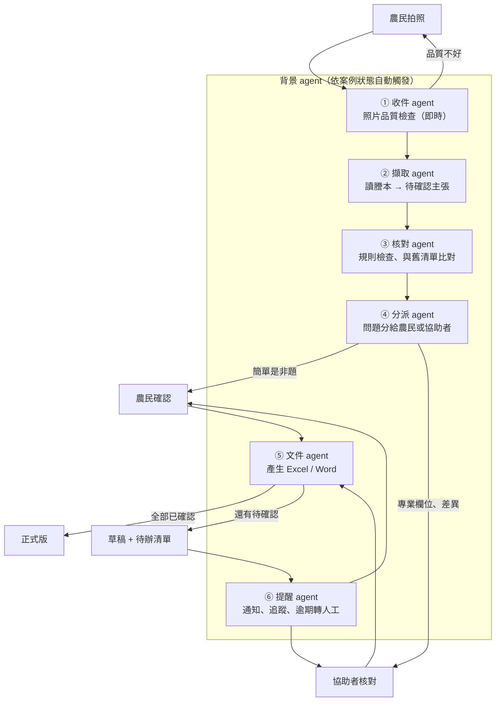

# 設計討論稿：高齡農民的簡化介面 + 背景 Agent 系統

> 狀態：MVP 範圍已定（見第 6 節），其餘為之後的設計方向。延續 [ontology-design.md](ontology-design.md)，把目標用戶從「行政協助者」擴大到**農民本人**。

> **2026-11-07 更新：取消協助者。** 使用者決定不要協助者這個角色，農民本人在手機上完成全部步驟：拍照 → 用「一樣／不一樣」核對 AI 讀出的資料 → 回答是非題（含法律注意事項）→ 選要簽幾年 → 下載同意書 → 紙本簽名。
> 第 2–5 節寫到「協助者」的分工是舊設計，**以第 6 節和 `AGENTS.md` 為準**。

## 1. 一句話設計原則

**農民只做三件事：拍照、回答「是／不是」、簽名。其他全部交給背景 agent 和協助者。**

## 2. 誰會用這個系統

| 角色 | 是誰 | 會做什麼 | 不該要他做的事 |
| --- | --- | --- | --- |
| **農民** | 所有權人、耕作人，多為高齡 | 拍謄本、確認「這是我的地嗎」、選類別、簽名蓋章 | 逐欄核對面積、地號、持分；學新 App；記帳號密碼 |
| **協助者** | 行政人員（如永錫的太太）、產銷班幹部、農會輔導員、農民的子女 | 核對專業欄位、處理退回、出正式文件 | 重複抄寫 |
| **背景 agent** | 程式 | 檢查照片、擷取、比對、分派問題、產文件、提醒 | 確認任何值、替人做決定 |

這個分工的關鍵是：**把「需要專業判斷的核對」從農民身上移到協助者身上**。農民只回答他本人最清楚的事（是不是我的地、誰在耕作、怎麼耕作）。

## 3. 高齡友善 UI 規則

### 看得清楚
- 內文至少 **20px**，重要數字 28px 以上；不用淺灰字。
- 高對比（深字淺底），顏色之外一定搭配文字或圖示，不靠顏色區分狀態。
- 每個按鈕都要有**圖示 + 文字**，不用只有圖示的按鈕。

### 點得到
- 按鈕高度至少 **56px**，按鈕之間留足間距。
- 只用「點一下」：不用滑動、長按、雙擊、拖曳。
- 每個畫面**只有一個主要按鈕**。

### 看得懂
- 一個畫面只做一件事，一次只問一個問題。
- 用農民自己的說法，例如「土地謄本」「地號」，不用「上傳」「同步」「提交」。
- 用**認得出來**取代**記得起來**：問「這是你的地嗎？」並附上謄本照片的那一小塊，而不是請他輸入地號。
- **每題都會唸出來，也都能用講的回答**（國語；台語先做朗讀）。設計見 [voice-design.md](voice-design.md)。

### 不怕按錯
- 沒有不能反悔的按鈕；按錯可以「回上一步」。
- 每題都有「**我不確定**」按鈕，按下去就轉給協助者，不卡住農民。
- 中斷了（接電話、沒電）再打開會停在原處。

### 不用登入
- 不要求帳號密碼。由協助者傳一個專屬連結，或用 LINE 登入。
- 子女可以代替長輩操作（代理人）。

## 4. 農民端只有四個畫面

```text
┌──────────────────────┐  ┌──────────────────────┐
│ ① 拍謄本              │  │ ② 收到了              │
│                      │  │                      │
│  ┌────────────────┐  │  │   ✔ 已經收到 2 張     │
│  │  對準框框        │  │  │                      │
│  │  （相機畫面）     │  │  │   處理好會用 LINE    │
│  └────────────────┘  │  │   通知你，不用等      │
│  第 1 張，共 2 張      │  │                      │
│                      │  │                      │
│ [ 📷  拍  照 ]        │  │ [ 🏠  回到首頁 ]      │
└──────────────────────┘  └──────────────────────┘
┌──────────────────────┐  ┌──────────────────────┐
│ ③ 請你確認（第 1/3 題）│  │ ④ 簽名               │
│  🔊 唸給我聽          │  │                      │
│  這是你的地嗎？        │  │  同意書已經準備好     │
│  ┌────────────────┐  │  │  請到 ○○ 找 △△ 簽名  │
│  │ 謄本照片局部     │  │  │  （MVP 用紙本簽名）  │
│  └────────────────┘  │  │                      │
│  霧峰區 ○○段 123 號    │  │                      │
│ [ ✔ 是 ] [ ✘ 不是 ]   │  │ [ 📞 打給 △△ ]       │
│ [ ？ 我不確定 ]        │  │                      │
└──────────────────────┘  └──────────────────────┘
```

- **① 拍謄本**：拍完 agent 馬上檢查照片品質，太暗、反光、切到邊就**當場**請他重拍（「有點暗，到亮一點的地方再拍一次」），不要等到隔天才退件。
- **② 收到了**：明確告訴他接下來不用做事、會怎麼被通知。
- **③ 確認**：每題都是「是／不是／我不確定」或二到四個大選項（例如類別：分耕、輪耕、託耕、承租），一頁一題。
- **④ 簽名**：MVP 維持紙本簽名蓋章，由協助者安排。

協助者端則是先前討論的「核對工作台」（Excel 核對表或小網頁），可以用比較密的介面。

## 5. 背景 Agent 系統

### 設計立場：固定流程 + 小而專的 agent，不做「自由發揮」的多 agent

高齡用戶的系統最重要的是**可預期、可追溯**。所以我們用**固定的狀態流程**串起幾個單一職責的 agent，每個 agent 只能呼叫 Ontology 裡被允許的 Action。這對應 Palantir 的做法：Automate（物件狀態改變就觸發）+ AIP Logic（LLM 步驟）+ Action（受控的寫入）。



### 每個 agent 的職責與權限

| Agent | 何時觸發 | 做什麼 | **可以** | **不可以** |
| --- | --- | --- | --- | --- |
| ① 收件 | 收到照片 | 檢查模糊、反光、缺角、頁數 | 請農民重拍 | 擷取內容 |
| ② 擷取 | 照片通過檢查 | 視覺 LLM 讀欄位，附頁碼、原文、照片位置 | 建立「待確認」主張 | 寫入已確認值 |
| ③ 核對 | 擷取完成 | 先跑固定規則（地號格式、持分加總、面積單位），再與舊清單比對 | 標記差異、缺漏、重複 | 自己選哪個對 |
| ④ 分派 | 核對完成 | 把每個待確認項目分給「農民」或「協助者」 | 建立待辦任務 | 跳過確認 |
| ⑤ 文件 | 有欄位被確認 | 依送出條件產生文件 | 出正式版或草稿 | 在未全部確認時出正式版 |
| ⑥ 提醒 | 任務逾期、租約將到期 | 發提醒；超過期限轉給協助者 | 通知**本案已登記的農民與協助者** | 聯絡其他第三人、催促簽名 |

### 分派規則（農民 vs 協助者）

| 問題類型 | 例子 | 給誰 |
| --- | --- | --- |
| 本人最清楚的事 | 這是你的地嗎？誰在耕作？哪一種耕作方式？ | 農民 |
| 需要專業的核對 | 面積、持分、地號、統一編號是否擷取正確 | 協助者 |
| 衝突或看不清楚 | 謄本和舊清單不一致、照片模糊 | 協助者 |
| 農民按「我不確定」 | 任何題目 | 自動轉協助者 |

### 共通護欄

- 每個 agent 的每次動作都寫入**操作紀錄**（誰、何時、改了什麼、依據哪張照片）。
- agent 失敗或不確定時，**一律轉人工**，不重試到「看起來成功」。
- 農民端的訊息全部由固定範本產生，不讓 LLM 自由發揮措辭，避免說錯話或語氣施壓。

## 6. MVP 決定（不再討論）

黑客松 MVP 直接採用以下做法，其餘延後。

| 項目 | MVP 做法 | 之後再做 |
| --- | --- | --- |
| 農民端形式 | **手機網頁**，大字大按鈕 | LINE 機器人 |
| 農民確認題目 | 這是你的地嗎？→ 每筆地、每位地主各一張卡「跟謄本上一樣嗎？」→ 誰在耕作？哪種耕作方式？→ 法律注意事項（依分數最多 3 題）→ 要簽幾年？ | 依實際需求增減 |
| 協助者 | **取消**。核對由農民本人做；看不清、不一樣、不確定的地方列在農民頁的待辦清單，同意書維持草稿 | 家人代理 |
| 測試資料 | **只用遮蔽樣本或虛構資料**，所以可以直接用雲端視覺 AI | 真實謄本的個資處理與同意流程 |
| 語音 | **要做**：預錄題目音檔＋國語語音回答（關鍵詞比對、唸回確認），見 [voice-design.md](voice-design.md) | 台語語音辨識、台語語音合成 |
| 簽名 | 農民在手機下載同意書，印出後紙本簽名蓋章；乙方耕作人姓名及 ID 簽署時手寫 | 線上簽名（需查效力） |
| 背景 agent | 做 ①收件 ②擷取 ③核對 ④分派（只排農民的題目）⑤文件（題目答完自動產生） | ⑥提醒 agent、通知 |
| 登入 | 不做，用專屬連結開啟 | LINE 登入、代理人 |

因為 MVP 不做提醒 agent，白皮書「不代替人聯繫第三人」的規則在 MVP 不會衝突。

## 7. 對既有設計的影響

- **Ontology 加一個物件**：「任務 Task」（誰要回答哪個問題、狀態）。「通知」物件延後。
- **「人」加角色欄位**：農民、協助者。代理人延後。
- **流程圖要更新**：泳道從「使用者」拆成「農民」和「協助者」。
