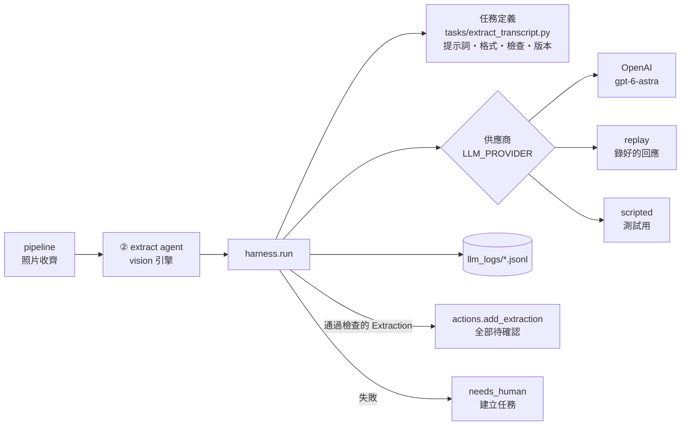

# LLM harness 設計

> 狀態：已實作（`app/llm/`），13 項離線測試通過；2026-11-07 用真的 OpenAI（`gpt-6-astra`）跑評分，C01–C03 全數通過（見第 7 節）。

## 1. 為什麼需要 harness

後端只有一個地方用到大型語言模型：**② 擷取 agent 讀謄本照片**。但這一步錯了，後面全部都錯，所以呼叫模型不能只是「丟圖、拿字」。harness 負責：

| 責任 | 做法 |
| --- | --- |
| 統一介面 | 所有任務都透過 `harness.run(任務, 供應商, 圖片)`；換供應商不改任務 |
| 格式保證 | OpenAI 結構化輸出（`responses.parse` + Pydantic）＋ harness 自己再驗證一次 |
| 內容檢查 | 每個任務自帶檢查（地號格式、對不到的土地、沒有所有權人…） |
| 修正重試 | 檢查不通過時，把問題清單附在下一次請求，最多 2 次；還不行就丟錯，流程轉人工 |
| 不猜護欄 | 提示詞要求看不清填「待確認」；評分把「猜測」列為頭號指標；結果只能經 `actions` 寫成「待確認」 |
| 紀錄 | 每次呼叫寫一行 JSONL：任務、提示詞版本、模型、token、耗時、成功與否。**不寫圖片與欄位值** |
| 離線測試 | `ScriptedProvider`、`ReplayProvider`：不連網、不花錢 |
| 評分 | 用 3 組假謄本逐欄比對答案檔 |

## 2. 架構



## 3. 檔案

| 檔案 | 內容 |
| --- | --- |
| `app/llm/base.py` | 共用型別：`LLMRequest`、`LLMResponse`、`Task`、錯誤類別 |
| `app/llm/harness.py` | 主流程：呼叫 → 驗證 → 整理 → 檢查 → 重試 → 紀錄 |
| `app/llm/openai_provider.py` | OpenAI Responses API。圖片先縮到長邊 2400 px 再以 base64 傳送 |
| `app/llm/replay.py` | `ScriptedProvider`、`ReplayProvider`、`RecordingProvider` |
| `app/llm/providers.py` | 依 `LLM_PROVIDER` 選供應商；測試用 `override()` |
| `app/llm/tasks/extract_transcript.py` | 謄本擷取任務：系統提示、輸出格式、後處理與檢查、`PROMPT_VERSION` |
| `app/llm/evaluate.py` | 評分 |
| `tools/eval_extract.py` | 評分指令 |

## 4. 一次呼叫的流程

1. 組請求：系統提示（規則）＋每張照片前標「第 N 頁，檔名 xxx」＋指示。
2. 供應商回傳 JSON 文字。
3. **Pydantic 驗證**：欄位齊全、型別正確、沒有多餘欄位。
4. **確定性整理**：去掉謄本的星號補位、「平方公尺」、千分位逗號；權利範圍統一成「全部 1分之1」。只做不會改變意思的整理。
5. **內容檢查**：地號是 `0000-0000`、面積是數字、權利範圍有「分之」、統一編號像 `A12345****`、每筆所有權對得到土地、每筆土地至少有一位所有權人、來源檔名和頁碼存在。
6. 有問題：把問題列給模型重來一次。第 2 次還不行 → `LLMOutputError` → 案例標成「需人工處理」並建立任務。

## 5. 不猜的三道防線

1. **提示詞**：看不清一律填「待確認」，在 `pending` 說明原因；不推測、不補、不改寫。
2. **內容檢查**：格式不對的值不會被接受，模型只能改成正確格式或「待確認」。
3. **動作層**：harness 不寫資料；擷取結果經 `actions.add_extraction` 全部建立為「待確認」，只有協助者能確認。

## 6. 供應商設定（`.env`）

```text
LLM_PROVIDER=openai            # openai | record | replay
OPENAI_API_KEY=...
OPENAI_MODEL=gpt-6-astra       # 旗艦；省錢可試 gpt-6-luna，但要重新評分
OPENAI_REASONING_EFFORT=high
EXTRACT_ENGINE=vision          # 不設時：假謄本案例用 oracle（答案檔），其他用 vision
```

`OPENAI_MODEL` 預設值取自 OpenAI 官方模型頁（2026-11-07 查詢）。

## 7. 評分

```bash
.venv\Scripts\python tools/eval_extract.py              # 用真的模型跑 C01–C03（照片版）
.venv\Scripts\python tools/eval_extract.py --clean      # 改用乾淨掃描頁
```

- **通過條件**：猜測 0、正確率 100%。有任何猜測時結束代碼為 1。
- 輸出寫到 `data/output/evals/`，檔名含提示詞版本與供應商，方便比較。
- `LLM_PROVIDER=record` 跑一次會把回應錄到 `tests/fixtures/llm/`；之後 `LLM_PROVIDER=replay` 可以不花錢重播，也可當展示時的備案。

| 案例 | 測什麼 |
| --- | --- |
| C01 | 正常：2 筆地、1 位所有權人 |
| C02 | 共有：2 人各 2分之1，跨頁 |
| C03 | 陷阱：同地號不同段、前導零、面積接近進位、**污損的權利範圍必須回「待確認」** |

### 第一次實測結果（2026-11-07，`extract-v1`，照片版）

| 案例 | 結果 | 正確欄位 | 猜測 | 重試 | 耗時 | token（入／出） |
| --- | --- | --- | --- | --- | --- | --- |
| C01 正常 | 通過 | 10 / 10 | 0 | 0 | 10.1 秒 | 6,708 ／ 563 |
| C02 共有跨頁 | 通過 | 7 / 7 | 0 | 0 | 6.0 秒 | 6,708 ／ 423 |
| C03 陷阱 | 通過 | 10 / 10 | 0 | 0 | 12.5 秒 | 6,708 ／ 755 |

C03 污損的權利範圍正確回「待確認」，同地號不同段也分得開。回應已錄在 `tests/fixtures/llm/`，`LLM_PROVIDER=replay` 可離線重播。

限制：假謄本是電腦排版的乾淨文字，真實謄本照片（反光、彎曲、手寫註記）會更難；拿到遮蔽過的真實樣本後要再評分。

## 8. 改提示詞的規則

1. 修改 `tasks/extract_transcript.py` 的 `SYSTEM`，並把 `PROMPT_VERSION` 加一（例如 `extract-v2`）。
2. 跑評分，和上一版比較；猜測不能變多。
3. 錄好的回應以提示詞內容做雜湊，改提示詞後舊錄音會自動失效，需重錄。

## 9. 測試（`tests/test_llm.py`，全部離線）

- 3 組假謄本的「完美輸出」都拿到 100%
- 星號補位被清掉、前導零保留、污損欄位維持「待確認」
- 模型把污損欄位猜成「全部 1分之1」時，評分抓到 1 次猜測
- 第一次輸出格式錯 → 帶著問題清單重試 → 第二次通過
- 兩次都錯 → 丟錯；整條流程中案例轉為「需人工處理」
- 紀錄檔裡沒有姓名、身分證號、地號
- 透過 API 走完整流程時，模型輸出的 12 個欄位全部是「待確認」

## 10. 之後

- 實際照片若拍得歪斜或分頁不清，考慮先做「頁面偵測與裁切」再送模型。
- 其他可能的 LLM 任務（例如語音關鍵詞比對失敗時，從固定選項挑一個）沿用同一套 `Task` 定義與評分方式。
