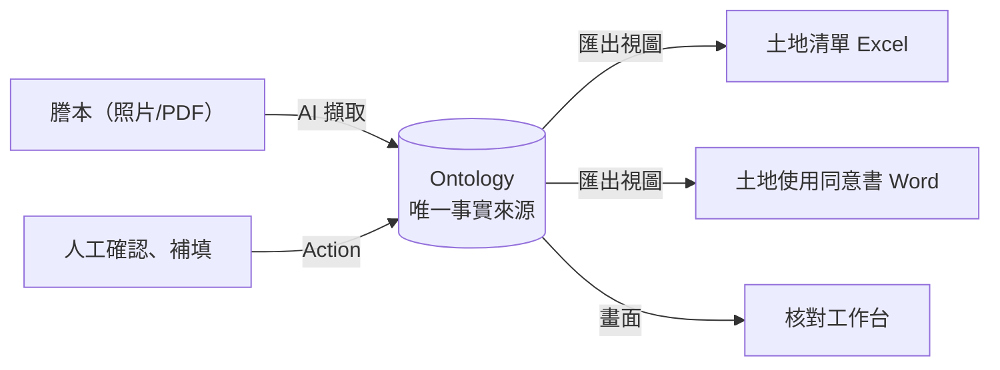
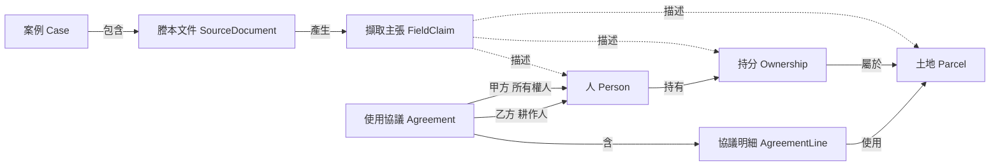
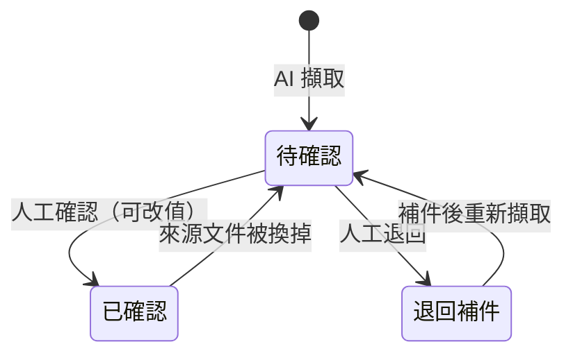
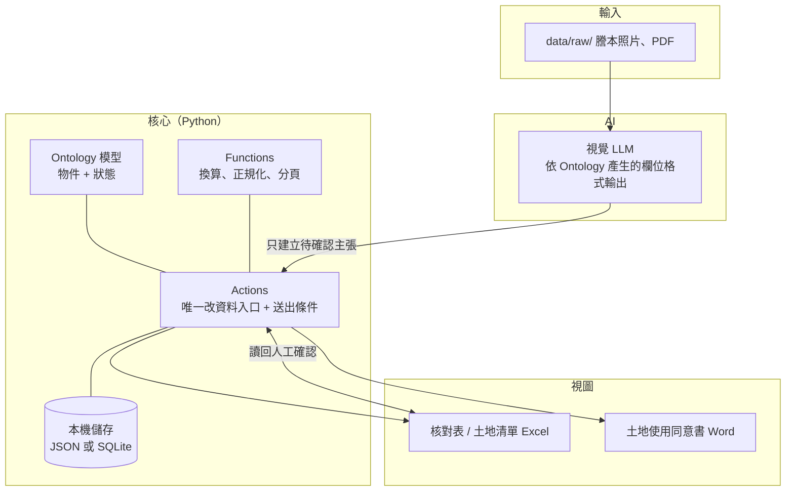

# 系統設計討論稿：借 Palantir Ontology 的思路

> 狀態：討論稿，尚未定案。目的是讓團隊在動手前對「資料長什麼樣、誰能改什麼、畫面怎麼做」有共識。
> 需求來源：[whitepaper.md](whitepaper.md)。

## 1. 為什麼參考 Palantir Ontology

Palantir Foundry 的 Ontology 是一層「業務語意層」：把散落在各處的原始資料（表格、文件、系統）對應成業務人員看得懂的**物件**，再規定這些物件**能被怎麼改**。前端 App、AI、報表都只透過這一層讀寫，不直接碰原始檔案。

我們的痛點正好是它要解決的問題：**同一筆資料在謄本、Excel、Word 之間抄三次**，每份檔案都可能被改，最後不知道哪份才對。

我們借的是**概念**，不是產品。Foundry 是大型企業平台，黑客松一天內只取最小、最有用的部分。

### Ontology 的核心元素，以及對應到本專案

| Palantir 概念 | 意思 | 在本專案 |
| --- | --- | --- |
| **Object Type**（物件型別） | 業務上的「名詞」，有主鍵、屬性 | 土地、人、持分、使用協議、擷取主張… |
| **Property**（屬性） | 物件的欄位，有型別 | 地號（文字）、面積（數值＋單位）、持分分子/分母 |
| **Link Type**（關聯） | 物件之間的關係與數量（1 對多…） | 人 —持有→ 持分 —屬於→ 土地 |
| **Action Type**（動作） | 業務上的「動詞」：唯一能改資料的入口，有參數、**送出條件**、權限 | 確認欄位、退回補件、產生同意書 |
| **Function**（函式） | 可重用的計算邏輯 | 面積換算、權利面積、地號正規化、7 列分頁 |
| **Markings / 權限** | 細到屬性層級的存取控制 | 身分證號、姓名只有資料持有人看得到原值 |
| **Lineage**（血緣） | 每個值從哪來、經過什麼處理 | 每個欄位追到「哪個檔、第幾頁、原文」 |
| **App 建在 Ontology 上**（Workshop、OSDK） | 前端只綁物件與動作，不綁原始表 | 核對畫面、Excel、Word 都只是 Ontology 的「視圖」 |
| **AIP：AI 透過 Action 做事、人審核** | AI 只能「提議」，人按確認才生效 | AI 擷取結果一律是「待確認的主張」 |

## 2. 最關鍵的轉念：Excel 和 Word 是「視圖」，不是資料

現在的流程：謄本 → **抄進** Excel → **重打** Word。每一步都產生一份新的「真相」。

Ontology 思路：

好處：

- Excel 清單和 Word 同意書**永遠一致**，因為都從同一份資料產生。
- 白皮書的懸案「共有地號在清單要一列還是多列」不再是資料問題，而是**視圖問題**：資料存「一筆土地 + 多筆持分」，清單要怎麼排、同意書怎麼分頁都可以之後再決定。
- 「超過 7 筆要分頁」也是視圖規則，不影響資料。

## 3. 本專案的 Ontology 草案

### 物件與關聯

| 物件 | 主鍵 | 主要屬性 | 值從哪來 |
| --- | --- | --- | --- |
| 案例 Case | `C01` | 負責人、建立時間 | 人工 |
| 謄本文件 SourceDocument | 檔名＋頁碼 | 檔案路徑（指向 `data/raw/`）、頁數 | 上傳 |
| 土地 Parcel | 縣市＋鄉鎮＋段＋小段＋地號（**全部文字**） | 謄本面積（原值＋單位）、登打面積(公頃)、證書面積、現地作物、備註 | 坐落/面積：AI；其餘：人工 |
| 人 Person | 內部代碼（農民 A） | 姓名、身分證號（**個資，需遮蔽**） | AI（所有權人）／人工（耕作人） |
| 持分 Ownership | 土地＋人 | 分子、分母 | AI |
| 使用協議 Agreement | 協議代碼 | 類別（分耕/輪耕/託耕/承租）、實施期間、狀態（草稿/正式） | **人工** |
| 協議明細 AgreementLine | 協議＋土地 | 本筆面積、權利面積（由函式算） | 函式 |
| 擷取主張 FieldClaim | 自動流水號 | 欄位名、來源頁碼、**來源原文**、AI 值、人工確認值、狀態、確認人、時間 | AI 建立，人改狀態 |

設計重點：

- **持分要獨立成物件**。在 Palantir 裡，關聯本身不能帶屬性；需要帶屬性（分子/分母）的關係，要做成中介物件。這也自然處理了「一筆地多位所有權人」。
- **「人」只有一種物件，角色由關聯決定**。同一個人可以既是所有權人也是耕作人，但系統**絕不自動合併**兩筆「人」；合併只能由人工 Action 做。
- **擷取主張（FieldClaim）是整個系統的核心**。AI 寫入的不是「土地的面積」，而是「AI 主張第 1 頁寫的面積是 X」。只有人工確認後，值才進到土地物件上。這就是白皮書「核對表最小欄位」的物件化。

### 擷取主張的狀態

### 動作（Action）與送出條件

白皮書的硬規則，正好可以寫成每個 Action 的**送出條件**，由程式擋下，而不是靠人記得：

| Action | 誰可以做 | 送出條件（不符就擋） |
| --- | --- | --- |
| 上傳謄本 | 使用者 | 檔案放在 `data/raw/` |
| AI 擷取 | 系統 | 只能建立「待確認」的主張，**不能寫已確認值**；看不清就留空並標待確認 |
| 確認欄位 | 老婆 / 地政隊員 | 必須記錄確認人；確認值與 AI 值不同時要保留兩者 |
| 解決衝突 | 老婆 | 謄本與舊清單不一致時，由人選邊；AI 不能選 |
| 補人工欄位 | 老婆 | 類別只能從 4 個選項選；耕作人不得預設為所有權人 |
| 合併兩個「人」 | 老婆 | 需人工明確指定，系統不自動做 |
| 產生同意書 | 老婆 | 所有明細的關鍵欄位都「已確認」才能出**正式版**；否則只能出浮水印「草稿」 |

### 函式（Function）：未定的規則要「參數化」，不要寫死

| 函式 | 現況 | 做法 |
| --- | --- | --- |
| 面積換算 m² → 公頃 | 小數位數、捨去或進位**未確認** | 規則做成設定值；未設定時函式回傳「待確認」，不給數字 |
| 權利面積 | 公式**未確認**（猜測是面積 × 持分） | 同上，未確認前不計算 |
| 地號正規化 | 需保留前導零與點碼 | 一律存文字，只做比對用的正規化，不改原值 |
| 同意書分頁 | 每頁 7 列，超過的規則未確認 | 視圖層處理 |

## 4. 前端開發方式分析

使用者是**老婆**，她熟悉 Excel 和 Word，不是工程師。白皮書的驗收標準是「她自己跑完一次並願意再用」。所以前端的第一原則是**不要逼她學新東西**。

| 方案 | 長相 | 優點 | 缺點 | 一天做得完？ |
| --- | --- | --- | --- | --- |
| **A. Excel 當前端** | 程式產生一份「核對表 Excel」，有狀態下拉選單、來源頁碼、差異標色；她改完存檔，程式讀回來產生 Word | 她最熟；不用架網站；離線可用 | 很難並排看謄本圖片；讀回時要嚴格驗證她改過的格子 | ✅ 最穩 |
| **B. Streamlit 小網頁** | Python 寫的本機網頁：左邊謄本圖片、右邊欄位清單，按鈕確認／退回 | 可並排看原圖、可強制只用 Action 改資料；Python 一套到底 | 她要學新畫面；要開一個本機程式 | ✅ 可以 |
| **C. React 網頁 + API** | 完整前後端，接近 Palantir Workshop 的體驗 | 體驗最好、最好擴充 | 開發量大、一天風險高 | ❌ 適合黑客松後 |

**建議**：黑客松當天做 **A**（或 A + 一個最簡單的 B 畫面）。關鍵是**不管哪個前端，都只透過同一組 Action 改資料**。這樣今天做 Excel 版，之後要換成網頁也不用重寫核心。這就是 Palantir「前端綁 Ontology，不綁原始表」的價值。

不管哪個方案，「核對工作台」都要做到這幾點（白皮書使用者旅程第 3 步）：

1. **預設只顯示「待確認」和「有差異」的欄位**，不用整張逐格看。
2. 每個欄位旁邊看得到**來源原文與頁碼**。
3. 人工欄位（類別、耕作人、實施期間）用下拉或必填框，**空著就不能出正式版**。
4. 輸出的 Word 未完成時，一律寫上「草稿」。

## 5. 整體系統架構建議

- **一份 Ontology 定義，產生所有東西**：用 Python 的資料模型（例如 Pydantic）定義物件，同一份定義用來：要求 AI 照格式輸出、驗證人工輸入、產生 Excel 欄位、填 Word 範本。改一個地方，全部跟著改。
- **AI 只是 Ontology 的一個「使用者」**，權限最小：只能呼叫「建立待確認主張」這個動作。這是 Palantir AIP 的做法，也剛好就是白皮書的「AI 讀、填草稿、標差異；人確認」。
- **儲存放本機**，因為有個資。原始檔與產出都在 git 之外（已設定 `.gitignore`）。
- **Codex 和 Claude Code 寫程式時**，Ontology 定義就是最好的規格書，可以寫進 `AGENTS.md` 讓兩邊都照著做。

## 6. 重點討論題

開工前請團隊（特別是地政隊員和老婆）逐題拍板：

1. **唯一事實來源是誰？**
   建議是 Ontology（程式裡的資料），Excel 和 Word 都只是產出。但如果老婆習慣直接改 Excel，就要決定「她改的 Excel」要不要讀回來，以及讀回時的規則。

2. **物件邊界對不對？**
   請地政隊員確認：土地的主鍵（縣市＋鄉鎮＋段＋小段＋地號）夠不夠唯一？「持分」獨立成物件合不合理？一個人可能同時是所有權人和耕作人嗎？

3. **AI 擷取的值存成「主張」，會不會太麻煩？**
   好處是可追溯、不會偷偷覆蓋；代價是多一層確認。要決定哪些欄位一定要人確認（建議：地號、面積、所有權人、身分證、持分），哪些可以放寬。

4. **前端做 Excel 還是小網頁？**
   取決於老婆：她願不願意開一個新畫面？需不需要並排看謄本原圖？電腦老師能支援 Python 嗎？

5. **衝突時誰拍板，系統怎麼記？**
   謄本、舊清單、人工輸入三者不一致時，以誰為準？每次選邊要不要記錄原因？

6. **未定規則先怎麼處理？**
   面積換算、權利面積公式在確認前，是「整欄顯示待確認」，還是「先算但標示未驗證」？建議前者，以符合「不猜」的硬規則。

7. **個資權限怎麼分？**
   隊友開發時只能看遮蔽樣本；誰能看原始謄本？正式使用時檔案放在誰的電腦？

8. **一天內的最小 Ontology 是什麼？**
   建議只做：土地、人、持分、擷取主張、使用協議（含明細）五類，以及「AI 擷取、確認、補人工欄位、產生同意書」四個 Action。其他（文件齊備檢查、紅單、證書面積）延後。

## 7. 不要學過頭的地方

- 不需要 Foundry 那種資料管線、排程、版本分支。一天內用 JSON 或 SQLite 就夠。
- 不需要通用的「Ontology 管理介面」。物件定義寫在程式碼裡即可。
- 不要為了架構好看犧牲白皮書的第一目標：**老婆今天能親手跑完一份同意書**。
