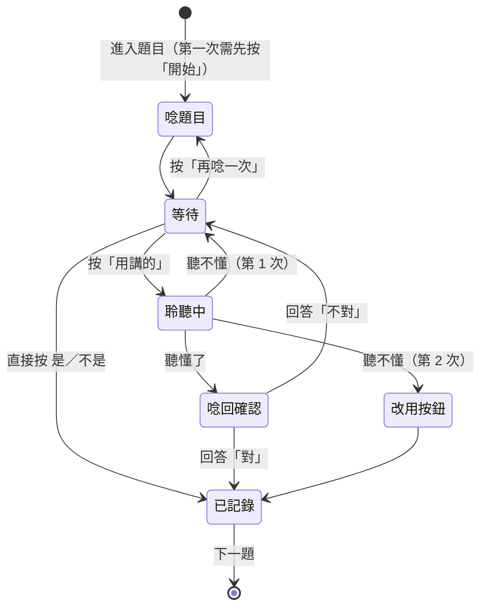

# 語音功能設計：讓高齡農民用「聽」和「講」完成確認

> 狀態：設計稿。MVP 範圍見第 7 節。延續 [farmer-ux-agents.md](farmer-ux-agents.md)。

## 1. 設計原則

1. **語音是主要溝通方式，按鈕永遠是備援**。每個能用講的地方，都能用按的完成；語音失敗時不會卡住。
2. **只問封閉式問題**。農民的回答只有「是／不是／不知道」或四種耕作方式，系統只需要從少數答案裡選一個，不需要理解自由對話，辨識才穩定。
3. **聽到什麼要唸回去確認**。「你講『不是』，對嗎？」確認後才記錄，避免聽錯就直接存。
4. **國語和台語都要能聽懂**。很多長輩習慣講台語。
5. **用熟悉的聲音**。題目由協助者本人錄音，長輩聽到熟人的聲音比較放心，也比較不會當成詐騙。
6. **錄音不保存**。只存辨識出的文字和最後的答案。

## 2. 兩個方向、兩種做法

| | 系統說話（朗讀） | 農民說話（辨識） |
| --- | --- | --- |
| **固定內容** | 題目、說明、鼓勵語：**事先錄好國語＋台語音檔**，最自然、離線也能播 | 是／不是／不知道、四種耕作方式：**關鍵詞比對** |
| **變動內容** | 地號、段名、姓名：**瀏覽器內建語音合成**（國語） | — |

固定的話占了 9 成以上，所以大部分都能用錄音檔，不依賴語音合成品質。

## 3. 農民端「回答問題」畫面的語音流程



畫面示意：

```text
┌──────────────────────────┐
│ 第 1 題，共 3 題           │
│ 這是你的地嗎？              │
│ ┌──────────────────────┐ │
│ │ 謄本照片局部           │ │
│ └──────────────────────┘ │
│ ○○鄉 ○○段 0123-0004       │
│                          │
│ [ 🔊 再唸一次 ]            │
│ [ 🎤 按一下，用講的 ]  ← 最大 │
│ [ ✔ 是 ]   [ ✘ 不是 ]      │
│ [ ？ 我不確定 ]            │
└──────────────────────────┘
```

### 互動細節

| 項目 | 做法 | 原因 |
| --- | --- | --- |
| 開始說話 | **按一下**開始，講完停頓約 1.5 秒自動結束，最長 6 秒 | 長輩按住不放很吃力，也違反「只用點一下」的規則 |
| 聆聽中 | 整個按鈕變色並有脈動圓圈，畫面寫「請說：是，或 不是」 | 讓長輩知道系統正在聽 |
| 唸題速度 | 比一般慢約 15%，音量提示「聲音太小請調大」 | 聽力退化 |
| 自動播放 | 第一題前要先按一次「開始」，之後每題自動唸 | 瀏覽器規定使用者先互動才能出聲 |
| 麥克風權限 | 跳出權限視窗**之前**，先用語音說明「等一下會問你可不可以用麥克風，請按『允許』」 | 權限視窗是長輩最容易卡住的地方 |
| 唸回確認 | 「你講『不是』，對嗎？」並把「不是」按鈕標亮；回答「對」或按亮起的按鈕就確認 | 防止聽錯 |
| 聽不懂 | 第 1 次：「我沒聽清楚，請再講一次」；第 2 次：「請按下面的按鈕」 | 不無限重試 |
| 吵雜環境 | 顯示聽到的文字，讓旁邊的家人也能幫忙看 | 田邊有風聲、機器聲 |

## 4. 關鍵詞比對表

辨識結果轉成文字後，用固定表比對，不讓 AI 自由解讀。台語欄是國語辨識器聽到台語時**可能**出現的文字，要在測試時依實際結果補充。

| 答案 | 國語說法 | 台語說法（羅馬字／常見寫法） |
| --- | --- | --- |
| 是 | 是、對、沒錯、是的、嗯 | 著（tio̍h）、是（sī）、係、嘿（heh） |
| 不是 | 不是、不對、沒有、錯了 | 毋是（m̄-sī）、毋著（m̄-tio̍h）、無（bô） |
| 不知道 | 不知道、不確定、不清楚 | 毋知（m̄-tsai）、無清楚 |
| 承租 | 承租、租、租的 | 稅（suè）、稅田、稅地 |
| 託耕 | 託耕、託人種、代耕 | 託人種、予人種 |
| 輪耕 | 輪耕、輪流種 | 輪流種 |
| 分耕 | 分耕、分開種 | 分咧種 |

規則：
- 同時比對到兩個答案（例如「不是…是」）→ 當成聽不懂，再問一次。
- 「不是」要比「是」優先比對，避免「不是」被誤判成「是」。
- 「誰在耕作？」只給兩個選項：「我自己」或「別人」。選「別人」就轉給協助者補姓名，不用語音輸入姓名和身分證號。

## 5. 技術做法

| 功能 | MVP 做法 | 之後 |
| --- | --- | --- |
| 固定語句朗讀 | 預錄 mp3（國語＋台語，由協助者錄） | 同左，擴充句庫 |
| 變動內容朗讀 | 瀏覽器 `speechSynthesis`，語言 `zh-TW` | 台語語音合成服務（待查可用性與費用） |
| 語音辨識 | 瀏覽器 `SpeechRecognition`，語言 `zh-TW`，Android Chrome 為主 | 支援台語的語音辨識服務或模型（待查） |
| 答案判斷 | 第 4 節的關鍵詞比對 | 關鍵詞比對失敗時，才讓 AI 從固定選項中挑一個，仍須唸回確認 |

技術限制（MVP 必須處理）：
- **麥克風只能在 HTTPS 或 localhost 使用**。手機連筆電的 `http://` 網址時無法收音，展示時要用 HTTPS 通道（例如 cloudflared、ngrok），或直接用筆電的 Chrome 手機模式展示。
- 瀏覽器的語音辨識會把聲音送到雲端（Google 或 Apple）。MVP 只用虛構資料，沒有問題；正式使用前要讓農民知情並同意。
- iPhone Safari 的語音辨識支援度不穩定，MVP 以 Android Chrome 展示。

## 6. 對既有設計的影響

- **Ontology「農民回答」要多記三個欄位**：回答方式（按鈕／語音）、辨識到的原文、唸回後是否確認。協助者在核對表看得到「語音回答，原文：毋是」。
- **AGENTS.md 的介面規則**：加上「每題都要能用講的回答，也都要能用按的回答」。
- **個資**：不存錄音檔，只存辨識文字。

## 7. MVP 範圍（3 小時內）

| 做 | 不做 |
| --- | --- |
| 3 題的預錄國語音檔（台語錄得到就加） | 台語語音辨識服務 |
| 按「再唸一次」播放題目 | 語音輸入姓名、身分證號、地號 |
| 3 題都能用國語回答，關鍵詞比對＋唸回確認 | 打電話的純語音版本 |
| 聽不懂兩次改用按鈕 | iPhone Safari 支援 |

**切分順序**（時間不夠就從下往上砍）：
1. 預錄音檔＋「再唸一次」按鈕（約 15 分鐘）
2. 語音回答「是／不是／不知道」＋唸回確認（約 45 分鐘）
3. 語音回答耕作方式（約 15 分鐘）

**驗收方式**：請永錫用國語和台語各回答 3 題，記錄每題「一次就聽懂」的比例，寫進驗收記錄。
